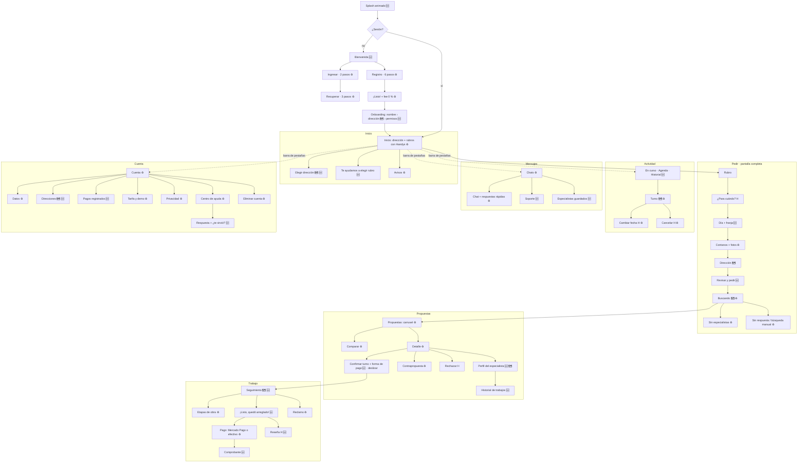

# Rediseño premium de la app de usuario de Handyx · Plan

Estado: **aprobado** (29/10/2026, con las decisiones recomendadas). **Lote 3.1 hecho: las 3 pantallas modelo esperan tu aprobación** antes de escalar. Reemplaza el trabajo visual de la Fase 3 (lotes 3.1–3.3) por
una Fase 3 rehecha en 9 lotes. Las Fases 4 y 5 no cambian de objetivo; se agregan los cambios de contrato que pide el
rediseño (sección 9).

## 1. Diagnóstico (por qué rehacerlo)

| Problema                         | Hoy                                                                  | Cómo lo resuelve el rediseño                                                                           |
| -------------------------------- | -------------------------------------------------------------------- | ------------------------------------------------------------------------------------------------------ |
| Se ve genérica, peor que la demo | tarjetas blancas planas, poca jerarquía, sin la hoja azul ni el mapa | dirección de arte propia sobre la demo: hojas azules, mapa, Handys vivos, tipografía con carácter      |
| Cabecera fija en todas partes    | logo + campana ocupan ~100 px en cada pantalla                       | cabecera solo en Inicio; título grande que se compacta al bajar; flujos y detalles a pantalla completa |
| Faltan pantallas                 | 33 pantallas, varias de la demo no existen                           | ~70 pantallas y estados (mapa al final), todas las de la demo adaptadas a las reglas                   |
| Acceso pobre                     | formularios sueltos de ingreso y registro                            | splash animado, bienvenida, ingreso y registro por pasos, permisos explicados, dirección en mapa       |
| Sin mapa                         | la ubicación es un formulario                                        | mapa propio de Mar del Plata: elegir dirección, zona, búsqueda en curso y especialista en camino       |
| Sin "momento Handyx"             | nada que se recuerde                                                 | splash con los Handys, búsqueda con pulso en el mapa, "¡Listo, quedó arreglado!"                       |

**Se conserva** (no se tira trabajo que funciona): capa de datos y contrato v1, servidor simulado (54 endpoints, 18
escenarios, panel de prueba), reglas de negocio, guardas de seguridad, tokens semánticos, auditoría de accesibilidad,
teclado, service worker y sin conexión, catálogo de capturas y todas las pruebas.
**Se rehace**: la capa visual completa (componentes, pantallas, navegación, movimiento).

## 2. Dirección de diseño: "Handyx"

La base es la demo de la landing (es la referencia que gusta). De apps on-demand (Rappi, PedidosYa, Uber) se toman los
**patrones** que la gente ya entiende, no su estética:

- dirección arriba del inicio, con selector ("Catamarca 1650 · La Perla ⌄");
- grilla de categorías grande y táctil;
- hojas inferiores sobre el mapa para buscar y seguir el trabajo;
- seguimiento en vivo con pasos (Confirmado › En camino › Llegó › Trabajando › Listo);
- botón principal fijo abajo, al alcance del pulgar;
- chat con respuestas rápidas.

Lo que **no** se copia: banners de promociones, recargos por urgencia, contadores que apuran, ETAs ("llega en 12 min"),
rankings de "más pedidos" o "mejor puntuado", y propinas o cargos agregados.

### Principios

1. **Tu casa en el centro.** El mapa y tu dirección orientan todo: pedir, buscar, seguir al especialista.
2. **Los Handys son los guías.** Cada rubro tiene su personaje (caño: plomería, lamparita: electricidad, llave:
   cerrajería, engranaje: aire, gota: gas, ladrillos: albañilería). Aparecen en vacíos, cargas, errores y festejos, y
   reaccionan al estado (las versiones "rotas" para errores ya existen).
3. **La hoja azul es la firma.** Las decisiones importantes viven en una hoja azul con manija sobre el mapa o la
   pantalla, como en la demo.
4. **Una decisión por pantalla.** Cada paso pregunta una sola cosa y el botón dice exactamente qué pasa ("Pedir
   presupuestos", "Confirmar turno").
5. **Transparencia que se ve.** Desglose siempre a la vista, comparación sin ranking, "reportado" ≠ "verificado",
   verificaciones solo con dato real.
6. **Movimiento con intención.** Transiciones compartidas (la tarjeta se abre en el detalle), hojas que se arrastran,
   personajes que reaccionan. Nunca para apurar una decisión; todo se apaga con "reducir movimiento".

### Lenguaje visual (tokens v2, sobre los semánticos actuales)

- **Color**: azul Handyx como superficie protagonista (hojas, cabecera de Inicio, paneles), amarillo como acento de acción
  y marcador; fondos hueso/gris muy claro para que lo azul respire; verde solo para "confirmado" y rojo solo para destructivo.
- **Tipografía**: Archivo 900 ensanchado para títulos grandes (el "¿Qué necesitás hoy?" de la demo), DM Sans para texto,
  cifras tabulares para importes; escala más amplia (títulos de 32–40 px en pantallas principales).
- **Forma**: radios grandes (24–36 px) en hojas y tarjetas, botones táctiles con base que se hunde (marca de la casa),
  íconos de línea de la landing en contenedores redondeados.
- **Profundidad**: tres niveles (plano, tarjeta, hoja) con sombras suaves y azuladas; desenfoque de fondo en hojas.
- **Mosaico**: el patrón de cuadrados redondeados de la marca, como textura en hojas azules, splash y estados vacíos.

## 3. Navegación y cabecera

| Tipo de pantalla                       | Cabecera                                                                                        | Barra inferior |
| -------------------------------------- | ----------------------------------------------------------------------------------------------- | -------------- |
| Inicio                                 | propia: dirección (selector) + avisos; el saludo y "¿Qué necesitás hoy?" bajan con el contenido | sí             |
| Pestañas (Actividad, Mensajes, Cuenta) | título grande que se compacta a una barra fina al bajar; sin logo                               | sí             |
| Detalle (pedido, propuesta, turno)     | barra fina con volver y título; sobre mapa o foto, volver flotante                              | no             |
| Flujos (pedir, registro, pago)         | pantalla completa con cerrar (X) y barra de progreso                                            | no             |
| Chat                                   | barra del interlocutor (avatar, nombre, rubro)                                                  | no             |
| Seguimiento                            | mapa a pantalla completa, volver flotante, hoja azul arrastrable                                | no             |

**Pestañas (4, como la demo):** Inicio · Actividad · Mensajes · Cuenta. "Actividad" junta lo que hoy está repartido en
Pedidos y Agenda: **En curso** (pedidos y trabajos activos, con lo que espera tu respuesta arriba), **Agenda**
(calendario de la demo) e **Historial**. En escritorio, la barra pasa a ser lateral (ya resuelto en 3.2).

## 4. Splash (pantalla de carga) nuevo

Distinto del de la landing (caño con gota y barra de progreso):

1. **Fondo que cambia de color**: azul Handyx › amarillo › azul personajes › azul Handyx, en transiciones suaves sobre el
   mosaico de la marca.
2. **Los Handys saltan**: caño, lamparita, llave, engranaje y gota entran de a uno con salto y aplastamiento (squash &
   stretch), cada uno sobre el color que le queda mejor.
3. **Final**: los personajes caen sobre el logotipo "Handyx", **se agarran de las letras** y quedan colgados mientras el
   logo se asienta; se funde a la app.

Detalle técnico: corre antes de que cargue la app (HTML y CSS en la primera pintura, sin esperar a React) y se ve solo al
abrir la app, no al navegar. Dura alrededor de 2 s y se salta con un toque; con "reducir movimiento", logo fijo. El
logotipo se arma en SVG con Archivo 900 para que los personajes puedan agarrarse de letras concretas.

> Interpreté "agarramos de las o" como "se agarran de las letras del logo". Si querías otra cosa (por ejemplo, que se
> agarren de la "x"), se ajusta en el lote 3.2.

## 5. Acceso (como las apps on-demand, con las reglas de Handyx)

- **Bienvenida**: pantalla completa azul con los Handys y 3 tarjetas deslizables ("Pedís en 1 minuto", "Comparás
  presupuestos reales", "Elegís vos, sin sorpresas"). Botones "Crear cuenta" y "Ya tengo cuenta".
- **Ingresar** en 2 pasos (email, después contraseña con ver/ocultar), "Olvidé mi contraseña".
- **Registro por pasos**:
  1. código de invitación (la demo es cerrada);
  2. email;
  3. contraseña con medidor;
  4. términos y privacidad;
  5. verificación de email (gate del proveedor de email: en el mock se simula);
  6. "¡Listo!" con el aviso del fee 0 % hasta el 10/12.
- **Onboarding**: nombre, **dirección en el mapa** (pin + calle y número + referencia), **permiso de ubicación y de
  avisos explicados antes** de que el navegador pregunte (pre-permiso), modal del fee en el primer ingreso.
- **Recuperar contraseña** en 3 pasos con estado de "revisá tu email".
- Sin login con Google ni Apple por ahora (Apple exige una cuenta paga y Google un proyecto propio: decisión 3).
- Sin teléfono ni SMS (costo y datos personales). Sin DNI.

## 6. Mapa

### Tecnología (sin cuentas ni costos, sin mandar ubicaciones a terceros)

- **MapLibre GL JS** (libre) + **mapa vectorial de Mar del Plata en un archivo PMTiles autoalojado** junto a la app en
  Hostinger (extracto de OpenStreetMap; decenas de MB, servido como estático). Sin claves, sin Google Maps ni Mapbox, sin
  pedidos a terceros: la ubicación de nadie sale de nuestros servidores.
- **Estilo propio Handyx** igual a la demo: manzanas gris claro, calles blancas, mar azul con costa amarilla, plazas
  verdes, nombres de barrio en mayúsculas espaciadas. Atribución "© OpenStreetMap" visible (licencia ODbL).
- **Barrios y cobertura** con polígonos locales (GeoJSON de OSM): "Estás en La Perla" sin servicios externos.
- **Búsqueda de direcciones**: no hay geocodificador gratis y propio. En v1 se marca con **pin + calle y número a
  mano**. Si se quiere autocompletar, hace falta un proveedor (decisión 6).
- Plan B si el extracto no se puede generar: capa vectorial simplificada de MDP (GeoJSON) con el mismo estilo.

### Dónde aparece

| Pantalla                     | Qué muestra                                                                                   |
| ---------------------------- | --------------------------------------------------------------------------------------------- |
| Elegir/editar dirección      | pin arrastrable sobre tu zona, barrio detectado, aviso si está fuera de cobertura             |
| Inicio                       | mini mapa de tu dirección en el selector de dirección                                         |
| Buscando especialistas       | tu casa con un pulso que se expande y "Buscando en La Perla"; sin especialistas ni tiempos    |
| Detalle de pedido y de turno | ubicación del trabajo                                                                         |
| Seguimiento ("en camino")    | especialista en movimiento **solo mientras viaja a tu casa y solo para ese trabajo**, sin ETA |
| Perfil del especialista      | zona donde trabaja (área, nunca su dirección)                                                 |

Privacidad: tu ubicación precisa solo con permiso puntual (nunca en segundo plano) y solo se comparte con el especialista
contratado. La del especialista es aproximada y deja de mostrarse al llegar. Lo que exige del backend está en la sección 9.

## 7. Componentes premium nuevos

- **Hoja arrastrable** (3 alturas, con manija, gesto y teclado) sobre mapa o pantalla.
- **Transiciones compartidas** (View Transitions): la tarjeta de propuesta crece hasta el detalle; el rubro vuela al
  encabezado del pedido.
- **Selector de día en tira** + **franjas horarias** (Mañana 8–10, 10–12, Mediodía, Tarde, Noche) como la demo, con
  calendario completo en hoja.
- **Carrusel de propuestas** deslizable con indicador y vista de comparación lado a lado.
- **Confirmar deslizando** ("Deslizá para confirmar") en la confirmación final de aceptar y de pagar, con alternativa
  accesible (botón + hoja). Es fricción deliberada contra el toque accidental; nada se mueve solo para apurar.
- **Stepper de seguimiento** animado (Confirmado › En camino › Llegó › Trabajando › Listo).
- **Respuestas rápidas** en el chat y tarjetas de propuesta dentro de la conversación.
- **Esqueletos con la forma real** de cada pantalla y **Handys reactivos** en vacíos y errores.
- **Festejo** al terminar ("¡Listo, quedó arreglado!") después del hecho, nunca antes de decidir.
- **Galería de componentes** (`/diseno/`, solo en la vista de prueba) para revisar todo el sistema en un lugar.

## 8. Plan paso a paso (Fase 3 rehecha)

Cada lote termina con capturas comparadas contra la demo, la auditoría de accesibilidad y teclado, las pruebas y los 18
escenarios en verde. Modelo recomendado: **Opus 5.5 · high** en todos (es trabajo de diseño y criterio). Rama:
`fase-3-diseno` (el PR #3 pasa a borrador y se completa con estos lotes).

| Lote | Objetivo                      | Entregable                                                                                                                                                                                                       | Comprobación de cierre                                                                               |
| ---- | ----------------------------- | ---------------------------------------------------------------------------------------------------------------------------------------------------------------------------------------------------------------- | ---------------------------------------------------------------------------------------------------- |
| 3.1  | Dirección de arte y sistema   | tokens v2, tipografía, mosaico, hoja arrastrable, botones, tarjetas, movimiento, galería `/diseno/`; **3 pantallas modelo** (splash, Inicio, Propuestas)                                                         | **punto de aprobación**: no se escala a las ~70 pantallas hasta que apruebes las 3 modelo            |
| 3.2  | Splash, acceso y onboarding   | splash animado, bienvenida, ingresar, registro (6 pasos), recuperar (3), pre-permisos, onboarding                                                                                                                | se entra y se registra sin teclado chiquito ni pantallas vacías; el fee 0 % aparece en sus 3 lugares |
| 3.3  | Mapa                          | MapLibre + PMTiles de MDP con estilo Handyx, elegir dirección, barrios y cobertura, mapa de búsqueda y de seguimiento                                                                                            | funciona sin conexión a terceros; ubicación solo con permiso puntual; atribución OSM visible         |
| 3.4  | Inicio y pedir                | Inicio con dirección, rubros con Handys, pedido en curso, flujo de pedido completo (rubro › cuándo › día › franja › contanos › fotos › dirección › revisar), buscando con mapa, sin especialistas, sin respuesta | pedir un servicio en menos de 1 minuto con el pulgar; sin ETA                                        |
| 3.5  | Propuestas y decisión         | carrusel y comparación, detalle, perfil e historial del especialista, confirmar turno con forma de pago, contrapropuesta, deslizar para confirmar                                                                | aceptar y rechazar inconfundibles; nada acordado sin confirmar; verificaciones solo reales           |
| 3.6  | Trabajo en curso y cierre     | seguimiento con mapa y stepper, "Llegué", obra por etapas, "¡Listo, quedó arreglado!", pago (Mercado Pago o efectivo), comprobante, reseña (decisión 2), reclamo                                                 | volver del checkout no confirma nada; reportado ≠ verificado; fee 0 % ≠ gratis                       |
| 3.7  | Actividad, mensajes y soporte | Actividad (en curso, agenda, historial), turno, cambiar fecha, cancelar, chats con respuestas rápidas, soporte (decisión 5), avisos                                                                              | toda acción de cambio es una propuesta que la otra parte acepta                                      |
| 3.8  | Cuenta y ayuda                | perfil con avatar, datos, direcciones guardadas, pagos registrados (sin tarjetas), avisos, privacidad, tarifa y demo, centro de ayuda con respuesta y "¿te sirvió?", eliminar cuenta                             | sin "Agregar tarjeta", sin HandIA, baja real                                                         |
| 3.9  | Pulido premium y QA           | transiciones compartidas, gestos, sin conexión, PWA, accesibilidad, catálogo completo de capturas y comparación lado a lado con la demo                                                                          | 0 fallas de axe, teclado y PWA; todas las pantallas y estados capturados                             |

**Orden y paralelismo:** 3.1 primero (con aprobación), 3.3 temprano porque 3.4–3.6 lo usan, el resto en orden.

### Adaptaciones obligatorias de la demo (reglas que no cambian)

| En la demo                          | En la app                                                                                |
| ----------------------------------- | ---------------------------------------------------------------------------------------- |
| "Tarifa de Handyx · cliente (5 %)"  | "Tarifa de Handyx 0 % · hasta el 10/12" (no se anuncian tarifas no aprobadas)            |
| "Pagar $ 47.250" dentro de la app   | "Pagarle a Especialista 1" (Mercado Pago directo o efectivo); Handy no cobra el servicio |
| Tarjetas y pagos, "Agregar tarjeta" | "Pagos registrados" (historial de pagos reportados/verificados), sin tarjetas            |
| HandIA                              | "Te ayudamos a elegir el rubro" con preguntas guiadas, sin IA ni datos a terceros        |
| "Verificado por Handyx"             | solo las verificaciones reales del backend ("Identidad verificada", etc.)                |
| "Cambiar al modo especialista"      | enlace a la app de especialista cuando exista (Fase 4.6)                                 |
| Contactos                           | decisión 4 (propuesta: "Especialistas guardados", sin números de teléfono)               |

## 9. Impacto en el backend y el contrato

El contrato es de `handyx-client-be`. Cada cambio sube la versión a `1.1.0-draft`. En la Fase 3 se modela en el mock y en
el contrato; en la Fase 4 se implementa de verdad.

| Necesidad del rediseño                      | Cambio de contrato                                                                                                                  | Fase real |
| ------------------------------------------- | ----------------------------------------------------------------------------------------------------------------------------------- | --------- |
| Direcciones guardadas (Casa, Trabajo)       | `direcciones` (lista con alias) y la dirección del pedido elegida de ahí                                                            | 4.2       |
| Especialista en camino en el mapa           | `trabajoUbicacionEspecialista` (aproximada, con vencimiento, solo en `en_camino`) + envío desde la app de especialista              | 4.4 / 4.6 |
| Perfil público e historial del especialista | `especialistaPerfil` (zona, horario declarado, rubros) y `especialistaHistorial` (rubro, qué se hizo, fecha; sin datos de clientes) | 4.3       |
| Reseñas (si se aprueban)                    | `resenaCrear` y promedio en el perfil (solo con un mínimo de reseñas reales)                                                        | 4.4       |
| Soporte por chat (si se aprueba)            | conversación con Operations (reusa `Conversacion` con otro interlocutor)                                                            | 4.4       |
| Especialistas guardados (si se aprueba)     | `favoritos` y "pedirle de nuevo" (opcional, nunca asignación obligatoria)                                                           | 4.3       |
| Barrios y cobertura en el mapa              | ninguno (polígonos locales); el servidor sigue validando la cobertura                                                               | —         |

## 10. Decisiones que necesito (cada una con una recomendación; si no decidís, avanzo con la recomendada)

1. **Pestañas**: Inicio · Actividad · Mensajes · Cuenta (recomendado) o mantener Pedidos y Agenda por separado.
2. **Reseñas** con estrellas y comentario después del trabajo: **sí** (están en la demo), con promedio visible solo a
   partir de 3 reseñas reales.
3. **Ingreso con Google**: **no por ahora** (requiere crear un proyecto OAuth propio; Apple requiere cuenta paga).
4. **Contactos de la demo**: **sí, como "Especialistas guardados"**, sin teléfonos, para "pedirle de nuevo" de forma
   opcional.
5. **Soporte por chat con Operations**: **sí** en el mock; en producción depende de que Operations lo atienda.
6. **Mapa**: **MapLibre + PMTiles autoalojado** (gratis, sin terceros). Autocompletar direcciones queda para cuando haya
   proveedor aprobado.
7. **Ubicación del especialista en camino**: **sí, aproximada y solo durante el viaje**, sin ETA.
8. **Deslizar para confirmar** en aceptar y pagar: **sí**, con alternativa accesible.
9. **Modo oscuro**: **después de la demo** (no entra en esta fase).
10. **Splash**: confirmar la interpretación de la sección 4.

---

## 11. Mapa de pantallas

Leyenda: 🆕 nueva · ♻️ rehecha · 🗺️ usa mapa · (H) hoja/modal. Las referencias `u-*` son pantallas de la demo de la landing.
Versión en imagen: [`screens/mapa-rediseno.png`](screens/mapa-rediseno.png).

### Inventario completo

| Sección    | Pantalla o estado                                                                            | Demo                                       | Estado | Lote |
| ---------- | -------------------------------------------------------------------------------------------- | ------------------------------------------ | ------ | ---- |
| Sistema    | Splash animado                                                                               | —                                          | 🆕     | 3.2  |
| Acceso     | Bienvenida (3 tarjetas)                                                                      | —                                          | 🆕     | 3.2  |
| Acceso     | Ingresar: email › contraseña                                                                 | —                                          | ♻️     | 3.2  |
| Acceso     | Registro: invitación › email › contraseña › textos › verificar › listo                       | —                                          | ♻️     | 3.2  |
| Acceso     | Recuperar: email › revisá tu email › nueva contraseña                                        | —                                          | ♻️     | 3.2  |
| Onboarding | Nombre · dirección en mapa 🗺️ · pre-permiso de ubicación · pre-permiso de avisos · modal fee | —                                          | 🆕     | 3.2  |
| Inicio     | Inicio (dirección, rubros con Handys, en curso, próximo turno)                               | u-inicio                                   | ♻️     | 3.4  |
| Inicio     | Elegir/editar dirección 🗺️                                                                   | —                                          | 🆕     | 3.3  |
| Inicio     | Te ayudamos a elegir el rubro                                                                | u-handia (sin IA)                          | 🆕     | 3.4  |
| Inicio     | Fuera de cobertura                                                                           | —                                          | ♻️     | 3.4  |
| Pedir      | ¿Para cuándo? (H)                                                                            | u-opciones                                 | ♻️     | 3.4  |
| Pedir      | Día en tira + franja horaria + calendario y hora (H)                                         | u-programar, u-elegir-fecha, u-elegir-hora | 🆕     | 3.4  |
| Pedir      | Contanos qué pasó + fotos                                                                    | u-describir                                | ♻️     | 3.4  |
| Pedir      | Dirección del pedido 🗺️ · Revisar y pedir                                                    | —                                          | 🆕     | 3.4  |
| Pedir      | Buscando 🗺️ (pulso, 0/3 propuestas)                                                          | u-buscando                                 | ♻️     | 3.4  |
| Pedir      | Sin especialistas · sin respuesta · búsqueda manual · 12 h sin propuestas                    | u-sin-especialistas                        | ♻️     | 3.4  |
| Propuestas | Carrusel / lista "Te llegaron N"                                                             | u-presupuestos                             | ♻️     | 3.5  |
| Propuestas | Comparar lado a lado                                                                         | —                                          | ♻️     | 3.5  |
| Propuestas | Detalle con desglose                                                                         | u-presupuestos                             | ♻️     | 3.5  |
| Propuestas | Perfil del especialista 🗺️ · historial de trabajos                                           | u-perfil, u-historial                      | 🆕     | 3.5  |
| Propuestas | Confirmar turno + forma de pago + deslizar                                                   | u-confirmar                                | 🆕     | 3.5  |
| Propuestas | Contrapropuesta · rechazar (H) · vencida · ya resuelta                                       | —                                          | ♻️     | 3.5  |
| Trabajo    | Seguimiento 🗺️ (stepper, en camino, llegó, trabajando)                                       | u-seguimiento                              | 🆕     | 3.6  |
| Trabajo    | Obra por etapas                                                                              | —                                          | ♻️     | 3.6  |
| Trabajo    | ¡Listo, quedó arreglado! · confirmar fin                                                     | u-terminado                                | 🆕     | 3.6  |
| Trabajo    | Pago: Mercado Pago / efectivo · retorno · comprobante                                        | u-terminado                                | ♻️🆕   | 3.6  |
| Trabajo    | Reseña (H)                                                                                   | u-resena                                   | 🆕     | 3.6  |
| Trabajo    | Reclamo: nuevo · detalle                                                                     | —                                          | ♻️     | 3.6  |
| Actividad  | En curso · Agenda (calendario) · Historial                                                   | u-turnos                                   | 🆕     | 3.7  |
| Actividad  | Turno 🗺️ · cambiar fecha (H) · cancelar (H)                                                  | u-turno-detalle, u-cambiar, u-cancelar     | ♻️     | 3.7  |
| Mensajes   | Chats · chat con respuestas rápidas · mensaje fallido                                        | u-mensajes, u-chat, u-chat2, u-chat3       | ♻️     | 3.7  |
| Mensajes   | Soporte · especialistas guardados                                                            | u-soporte, u-contactos                     | 🆕     | 3.7  |
| Mensajes   | Avisos (notificaciones)                                                                      | u-notificaciones                           | ♻️     | 3.7  |
| Cuenta     | Cuenta (avatar, accesos)                                                                     | u-cuenta                                   | ♻️     | 3.8  |
| Cuenta     | Datos · direcciones 🗺️ · pagos registrados                                                   | u-datos, u-pagos (sin tarjetas)            | ♻️🆕   | 3.8  |
| Cuenta     | Tarifa y demo (contador) · privacidad · avisos del celular · instalar                        | —                                          | ♻️     | 3.8  |
| Cuenta     | Centro de ayuda · respuesta + "¿te sirvió?"                                                  | u-ayuda, u-ayuda-detalle                   | ♻️🆕   | 3.8  |
| Cuenta     | Eliminar cuenta · solicitada                                                                 | —                                          | ♻️     | 3.8  |
| Sistema    | Sin conexión · error · 404 · sesión vencida (H) · actualización disponible · cargando        | —                                          | ♻️🆕   | 3.9  |
| Prueba     | Galería de componentes `/diseno/` · mapa de pantallas `/mapa/` · panel de prueba             | —                                          | 🆕♻️   | 3.1  |

Total: **~45 pantallas y ~70 estados**, contra 33 pantallas actuales.
