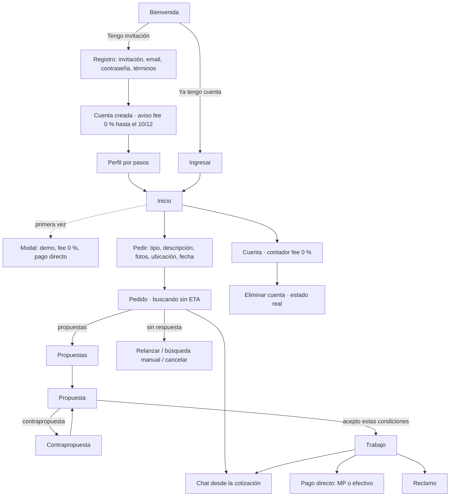

# Mapa funcional inicial (Fase 1 · lote 1.2)

La matriz completa pantalla → acción → estado → API → entidad → prueba está en [`matriz.md`](matriz.md) (generada desde
`src/mapa/`). Acá van los recorridos y las decisiones de producto que la gobiernan. El mapa final con capturas
(PROD-26) se actualiza al terminar el desarrollo (Fase 5 · lote 5.4).

## Recorrido principal

## Registro y perfil

- **Login** (separado del perfil): email + contraseña. Demo cerrada: **código de invitación** obligatorio
  (ADR-0002 del BE). Recuperación por email con token en el fragmento; mientras no haya proveedor de email, se informa
  escribir a soporte (gate).
- **Perfil operativo** (PROD-15, definido por Ignacio): nombre, apellido, fecha de nacimiento, nacionalidad, ubicación
  real y género. Por pasos, con "completar después"; lo que falta queda vacío. **No** se pide DNI, CUIT ni certificados.
- **Ubicación**: a mano o con permiso **puntual** de geolocalización; denegarlo no bloquea; nunca seguimiento en segundo
  plano. Otra ciudad: se registra el interés, sin cobertura ni pedidos como si la hubiera.
- **Preregistro de la landing**: no se convierte en cuenta ni se vincula automáticamente. El alta real exige invitación,
  textos aceptados y perfil completo.

## Fee 0 % (tres avisos, decisión de Ignacio)

1. **Después del registro** (`/registro/listo/`): "la tarifa de Handy es 0 % hasta el 10/12".
2. **Modal de primer ingreso** (sobre `/inicio/`): demo cerrada, fee 0 %, pago directo por MP o efectivo; registra la
   versión aceptada (`POST /v1/cuenta/fee/aceptacion`). Vuelve a aparecer solo si cambia la versión de la política.
3. **Contador en Cuenta** (`/cuenta/`): días/horas hasta el 10/12 con el reloj del servidor.

Siempre: el 0 % es la tarifa de Handy, **no** un descuento sobre el precio del especialista. Al vencer el contador no
se muestra ni se aplica ninguna tarifa sin política aprobada por el servidor (`siguiente.aprobada`).

## Bordes cubiertos por el mapa

Registro incompleto · fallo de sesión/sesión vencida · pedido sin oferta (20 min urgente / 12 h programado, sin ETA) ·
propuesta vencida (5 min urgente) · rechazo y contrapropuesta · aceptación duplicada · cancelación de pedido y de
trabajo · pago reportado vs verificado · retorno de checkout · reclamo · baja con retenciones · push denegado ·
sin conexión. Los 18 escenarios obligatorios del mock están en `src/mapa/escenarios.ts` y en la matriz.

## Pendientes de producto

- ¿El fee 0 % incluye el 10/12? Supuesto: termina el 10/12 a las 00:00 (Buenos Aires), porque los cupones aplican
  "desde el 10/12".
- Opciones de género y edad mínima (supuesto: 18).
- Reseñas y contactos guardados (están en la demo de la landing, no en el alcance v1 del prompt).
- Intentos de relanzamiento de búsqueda (supuesto: 3) y vigencia de propuestas programadas.
